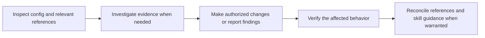

# doom-emacs-config

[](LICENSE)
[](https://github.com/CodeSigils/hermes-doom-config/actions/workflows/ci.yml)
[](https://github.com/CodeSigils/hermes-doom-config/security/code-scanning)

See [SECURITY.md](SECURITY.md) for vulnerability reporting and security scope.

My personal Doom Emacs configuration repo. Designed for org-mode, GTD workflows, and general development with Company completion.

## Quick Start

Requires [Doom Emacs](https://github.com/doomemacs/doomemacs) installed.

```sh
git clone https://github.com/CodeSigils/hermes-doom-config.git ~/.config/doom
doom sync
doom doctor
```

If you're an AI agent working in this repo, read [`AGENTS.md`](AGENTS.md) first for policy and its [Reference Map](AGENTS.md#reference-map), then consult the profile, skill, and API guidance relevant to the task.

## Agent Skill

The repo-bound [Doom skill](.agents/skills/doom-emacs/SKILL.md) assists with this
configuration. It uses this checkout for policies, root references, and scripts.
For local discovery, link `~/.agents/skills/doom-emacs` to the repository's
`.agents/skills/doom-emacs` directory using an absolute target. The repository
is the canonical source; the link does not copy or synchronize files.

## File Layout

| Path                         | Purpose                                                         |
| ---------------------------- | --------------------------------------------------------------- |
| `init.el`                    | Module declarations (single `doom!` form)                       |
| `packages.el`                | Package declarations (`package!` forms)                         |
| `config.el`                  | Thin loader with universal defaults and section `load!` calls   |
| `sections/appearance.el`     | Font, theme, line numbers                                       |
| `sections/spellcheck.el`     | Jinx spell-checking                                             |
| `sections/org.el`            | Org, Org-Roam, Org-Roam-UI                                      |
| `sections/input.el`          | Greek input method                                              |
| `sections/completion.el`     | Company backends, dabbrev                                       |
| `sections/navigation.el`     | Browser, window management, popups, frame                       |
| `sections/ui.el`             | Dirvish, which-key, smartparens, rainbow-delimiters             |
| `sections/formatting.el`     | Ruff (Python), Prettier (Markdown)                              |
| `sections/keys.el`           | All keybindings (loaded last)                                   |
| `snippets/`                  | Yasnippet templates per major-mode                              |
| `scripts/`                   | Repo tooling (validation and CI)                      |
| `references/`                | Best-practices, package management, external resource catalogue |
| `.agents/skills/doom-emacs/` | Agent skill with domain files for depth                         |

Add new settings and hooks to the matching section file. Add new keybindings to
`sections/keys.el`. Register a new section file with `(load! ...)` in `config.el`.



Illustrative workflow. Authoritative details: [Agent Workflow](AGENTS.md#agent-workflow).

## Agent Script Awareness

All repo scripts live under `scripts/`. The canonical reference for every script -- purpose, invocation, and when to run
-- is the Scripts table in [`.agents/skills/doom-emacs/SKILL.md`](.agents/skills/doom-emacs/SKILL.md).

```text
  AGENTS.md > Agent Workflow       --  policy and verification requirements
  ───
  SKILL.md > Scripts table         --  single source of truth for all scripts
  ───
  scripts/check-stale-patterns.sh  --  delegates to validate-docs.py, which checks stale
                                       guidance, selected local file paths, script registration,
                                       domain inventory, section inventory, and skill essentials
                                       coverage
```

- `AGENTS.md` owns repo workflow policy; the skill summarizes it and lists scripts.
- The path check covers selected inline link forms, including angle-bracketed and percent-encoded paths, and resolves Markdown links relative to their containing file. It is not a full Markdown parser; anchors and external URLs are not checked.
- `SKILL.md` is the single source for script metadata. Add or rename a script there, update the table.
- `check-stale-patterns.sh` enforces script-table coverage in both directions and preserves paths containing spaces.
- It also checks that every `sections/*.el` file is loaded from `config.el`, and every section loaded from `config.el`
  exists on disk.
- `scripts/config.sh` is a support library sourced by other scripts; it is never invoked directly and is excluded from
  the coverage check.

Run the network-free contracts before committing script changes:

```sh
scripts/run-offline-contracts.sh
```

CI runs documentation validation for Markdown, snippet, or script changes, offline contracts for script changes,
ShellCheck for shell-script changes, and `check-parens` for changed `.el` files. Workflow-file changes enable all
classifications; the Elisp job checks any changed `.el` files. Snippet-only changes run documentation validation.

## Notable Enabled Modules

See [`PROFILE.md`](PROFILE.md) for the full module table with flags by category, and [`DOOM-API.md`](DOOM-API.md) section 3 for how the module system
works. `init.el` is the source of truth.

Not currently enabled: Doom's `mu4e`, `irc`, `rss`, `rest`, `web`, `treemacs`, `nav-flash`, `multiple-cursors`,
`rotate-text`, and `editorconfig` modules are commented out in `init.el`.

## Key Features

- **Company completion** with file path expansion — `company-files` added to programming, configuration, text,
  Org, and Markdown mode backends; Markdown inline-code and link delimiters are preserved when completing paths
- **Split config layout** — `config.el` is a thin loader with universal defaults; per-feature config lives under
  `sections/*.el`, and all keybindings live in `sections/keys.el`
- **Dirvish** — `SPC d d` launches `dirvish-dwim`
- **Jinx spell checking** — fast Enchant/Hunspell-backed spell checking for prose and code comments/strings
- **Org mode** — org-roam, org-roam-ui, and org-tempo (`<s` Tab for src blocks)
- **Popup targets** — targeted rules for help, apropos, warnings, backtraces, messages, completions, compilation/shell
  command output, and `*doom:*` buffers
- **Snippets** — Yasnippet snippets live under `snippets/<major-mode>/`; the TypeScript snippets inherit JavaScript
  snippets through `.yas-parents`
- **Defensive setup** — `fboundp` guards on optional packages, `delete-by-moving-to-trash` globally

## Optional System Dependencies

`doom doctor` reports missing optional tools for some enabled modules and workflows. Install only what you use.

| Tool or package                        | Used by                       | Notes                                        |
| :------------------------------------- | :---------------------------- | :------------------------------------------- |
| Symbola or equivalent Unicode font     | Doom font checks              | Optional fallback symbol font                |
| `ansible`                              | `:tools ansible`              | Needed for Ansible editing helpers           |
| `dockfmt`                              | `:tools docker`               | Formats Dockerfiles                          |
| Markdown compiler                      | Markdown preview/export       | Use the compiler expected by your Doom setup |
| `maim`, `scrot`, or `gnome-screenshot` | org-download clipboard images | Needed only for `org-download-clipboard`     |
| `pyflakes`                             | Python syntax checking        | Optional Python checker                      |
| `isort`                                | Python import sorting         | Optional formatter/import sorter             |
| `pipenv`                               | Python environments           | Only needed for Pipenv projects              |
| `nosetests`                            | Python test runner            | Only needed for projects using nose          |

Python, shell, and YAML LSP support also requires a suitable language server
visible to Emacs. See the [LSP troubleshooting guide](.agents/skills/doom-emacs/domains/TROUBLESHOOTING.md#lsp-not-working)
and the [workflow smoke checks](.agents/skills/doom-emacs/domains/TROUBLESHOOTING.md#workflow-smoke-checks).

## Maintenance

```sh
# Before upgrading Doom, back up your config
cp -a ~/.config/doom ~/.config/doom.backup.$(date +%Y%m%d)

doom upgrade
doom sync
doom doctor
```

If something breaks, restore `~/.config/doom.backup.*` from the backup.

## Notes

- Runtime SQLite artifacts under `.open-mem/` are ignored; keep durable notes in human-readable files instead of
  committing WAL/SHM database state
- The repository skill is canonical; local discovery uses a link to it.
- Markdown files in this repo should not contain emoji, including generated status summaries or agent notes
- Unused modules are commented out in `init.el`, never deleted
- Add new settings/hooks/advice to the appropriate `sections/*.el` file; add keybindings to `sections/keys.el`
